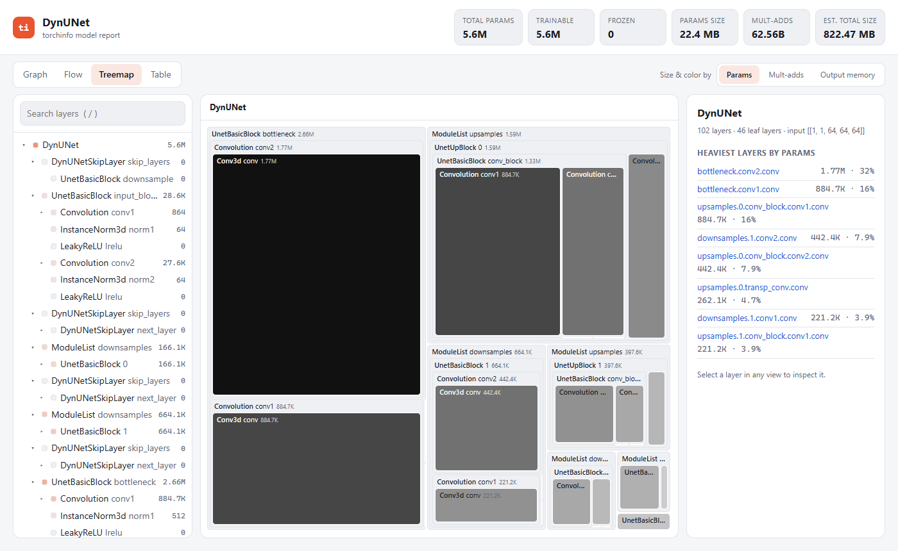
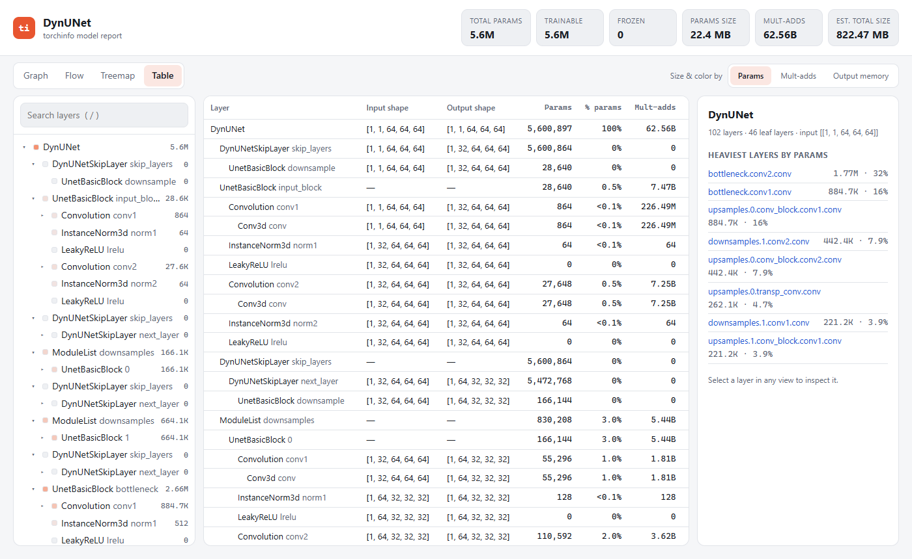

<p align="center">
  
</p>

<h1 align="center">torchinfo-viz framework</h1>

<p align="center">
  <b>See inside any PyTorch model.</b>
  <br>
  <a href="https://pypi.org/project/torchinfo-viz/"></a>
  
  
</p>

## Install

```bash
pip install torchinfo-viz
```

## Use

```python
from torchinfo import summary

stats = summary(model, input_size=(1, 3, 224, 224))

stats.show()                    # open the interactive report
stats.to_html("report.html")    # save a standalone report that works offline
stats.to_json("model.json")     # export raw data
stats.to_dict()                 # same data as a Python dict
print(stats)                    # classic text table
```

## Screenshots

| Treemap | Table |
|---|---|
|  |  |

## Common options

```python
summary(model, input_size=(16, 1, 28, 28))                 # input shape
summary(model, input_data=[x])                             # real tensors
summary(model, input_size=(1, 32), dtypes=[torch.long])    # token ids
summary(model, (1, 3, 224, 224), depth=5)                  # deeper tree
summary(model, (1, 3, 224, 224), device="cpu")             # pick device
summary(model, (1, 3, 224, 224), verbose=0)                # no printing
summary(model, (1, 3, 224, 224),
        col_names=["input_size", "output_size", "num_params", "mult_adds"])
summary(model)                                             # params only, no graph
```

## Check it on known models

```bash
git clone https://github.com/woletee/torchinfo-viz.git
cd torchinfo-viz
pip install torchvision monai einops      # optional model libraries
python examples/model_zoo.py --out zoo_reports
python examples/model_zoo.py --only resnet,unet
```

Open `zoo_reports/index.html` in a browser. 25/25 models pass on Python 3.11 + torch 2.15:

| Library | Models |
|---|---|
| torchvision | ResNet, VGG, EfficientNet, ViT, Swin |
| MONAI | UNet, DynUNet, UNETR, SwinUNETR |
| torch.nn | Transformer, LSTM |

## Develop

```bash
pip install -e .
pytest tests
```

## Credits

Built on [torchinfo](https://github.com/TylerYep/torchinfo) by Tyler Yep (MIT).
It installs the same `torchinfo` import, so uninstall the original `torchinfo` first.

## Demo video

<details>
<summary>▶ Click to watch the interactive report in action</summary>

<br>


[Full-quality video (MP4)](docs/images/demo.mp4)

</details>
